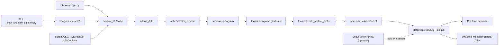

# Solución para el análisis de anomalías de autenticación

Este repositorio contiene un prototipo de análisis por lotes para priorizar intentos de autenticación que se apartan de los patrones observados. La solución transforma registros de acceso en señales de riesgo y entrega eventos para investigación, no bloquea accesos ni determina por sí sola que una actividad sea maliciosa.


## Problema y objetivo

Los sistemas de autenticación generan registros con contexto como usuario, hora, dirección IP, ubicación, proveedor de red y resultado del login. Las reglas estáticas pueden detectar patrones conocidos, pero no siempre priorizan combinaciones inusuales de señales ni cambios respecto al historial de un usuario.

El objetivo de esta solución es procesar esos registros, calcular señales de comportamiento y asignar un score de anomalía para apoyar la revisión de un analista. La hipótesis de trabajo es que un modelo no supervisado puede ayudar a priorizar combinaciones poco frecuentes incluso cuando no se dispone de una etiqueta confiable para cada evento. Esta hipótesis requiere evaluación con datos separados antes de considerarse validada.

## Arquitectura

La solución ofrece dos interfaces locales, CLI y Streamlit, que usan el mismo pipeline. Ambas reciben una ruta local; ninguna implementa por su cuenta las transformaciones o el detector.



El pipeline identifica columnas y roles semánticos, limpia valores, construye variables y genera scores y alertas. Si existe una etiqueta de referencia, calcula métricas supervisadas; esa etiqueta se excluye de la matriz de entrenamiento. El módulo `auth_anomaly_pipeline.py` conserva el comando histórico y delega en el paquete `auth_anomaly/`.

| Módulo | Responsabilidad |
|---|---|
| `auth_anomaly/io.py` | Lectura de archivos locales y aplicación de límites de filas cuando el formato lo permite. |
| `auth_anomaly/schema.py` | Normalización de columnas, inferencia de roles y limpieza. |
| `auth_anomaly/features.py` | Variables de autenticación, codificación y escalado. |
| `auth_anomaly/detection.py` | Isolation Forest, métricas y explicaciones basadas en reglas. |
| `auth_anomaly/pipeline.py` | Orquestación por ruta y contrato `PipelineResult` para la interfaz. |
| `auth_anomaly/cli.py` | Argumentos y salida de terminal. |
| `app.py` | Interfaz Streamlit; configura el análisis y presenta resultados. |


## Componente de inteligencia artificial

El detector utiliza `IsolationForest` de scikit-learn. Recibe una matriz numérica construida a partir de variables de los registros y devuelve un score de anomalía y una predicción binaria según el parámetro `contamination`.

Las explicaciones que acompañan algunas alertas son reglas de contexto, por ejemplo, IP nueva para el usuario o cambio de país, no explicaciones causales del modelo. Una alerta es una señal para investigar, no una confirmación de ataque.

El valor de este enfoque es explorar combinaciones inusuales sin necesitar etiquetas para entrenar el detector. Su limitación es que `contamination` influye en cuántos registros se marcan como anomalías; no representa la incidencia real de ataques ni una tasa de aciertos.

## Dataset de referencia


Para el objetivo de análisis de autenticaciones, el dataset recomendado es [Login Data Set for Risk-Based Authentication (RBA)](https://www.kaggle.com/datasets/dasgroup/rba-dataset). Contiene más de 33 millones de intentos de login y el CSV publicado ocupa aproximadamente 9,05 GB. El dataset se describe como completamente sintético: es útil para investigación y demostración, pero no debe utilizarse en sistemas productivos. Kaggle indica licencia CC BY 4.0; si se publican resultados, debe reconocerse la fuente y citarse el artículo asociado: Wiefling et al., *Pump Up Password Security!*, 2022, [doi:10.1145/3546069](https://doi.org/10.1145/3546069).

El dataset también incluye `Is Attack IP` y `Is Account Takeover`. Para evaluar la hipótesis de detección de toma de control de cuentas, se recomienda usar explícitamente `Is Account Takeover` como etiqueta de referencia. `Is Attack IP` responde a otro criterio y no debe interpretarse como sinónimo de account takeover.

### Descarga desde Kaggle

1. Instalar la CLI de Kaggle en el entorno de Python: `python -m pip install kaggle`.
2. En Kaggle, abrir la configuración de la cuenta, crear un token API y configurar el archivo `kaggle.json` en `~/.kaggle/kaggle.json` (Linux/macOS). Restringir sus permisos con `chmod 600 ~/.kaggle/kaggle.json`. No subir ese token al repositorio.
3. Descargar y extraer el CSV:

```bash
mkdir -p data/rba
kaggle datasets download -d dasgroup/rba-dataset -p data/rba --unzip
```

El archivo esperado es `data/rba/rba-dataset.csv`. `--sample-rows 5000` limita las filas que procesa el pipeline, pero **no** reduce el tamaño que se debe descargar de Kaggle. Se necesita espacio suficiente para el archivo completo.

## Dataset alternativo de flujos de red

[Network Intrusion dataset (CIC-IDS2017)](https://www.kaggle.com/datasets/chethuhn/network-intrusion-dataset) contiene CSV de flujos de red con actividad normal y ataques; el conjunto publicado en Kaggle ocupa aproximadamente 885 MB repartidos en ocho archivos. La página de Kaggle enlaza al [dataset original de CIC-IDS2017 de UNB](https://www.unb.ca/cic/datasets/ids-2017.html) y presenta su propia información de licencia.

```bash
mkdir -p data/cicids2017
kaggle datasets download -d chethuhn/network-intrusion-dataset \
  -p data/cicids2017 --unzip
```

CIC-IDS2017 puede servir para un experimento separado de detección de intrusiones en red. No contiene el mismo tipo de evento que RBA: sus filas representan flujos, no intentos de autenticación. Aunque el cargador acepta CSV y el pipeline puede procesar variables numéricas, las variables de historial de usuario, login, geolocalización de acceso e IP nueva están diseñadas para autenticaciones.

## Instalación y ejecución

Se requiere Python 3.10 o posterior. Instala las dependencias de ejecución en un entorno virtual:

```bash
python3 -m venv .venv
source .venv/bin/activate
python -m pip install --upgrade pip
python -m pip install -r requirements.txt
```

En Windows, activar el entorno con `.venv\Scripts\activate` en lugar de `source .venv/bin/activate`.

Una vez descargado RBA, el comando de referencia es:

```bash
python auth_anomaly_pipeline.py data/rba/rba-dataset.csv \
  --sample-rows 5000 \
  --contamination 0.02 \
  --schema-map '{"attack_label":"Is Account Takeover"}'
```

`--schema-map` permite corregir explícitamente el rol de una columna. La etiqueta se utiliza para calcular métricas y no como variable de entrenamiento. `--sample-rows` toma las primeras N filas del archivo; el resultado depende de ese subconjunto y no necesariamente representa el dataset completo.

### Interfaz Streamlit

Con el mismo entorno virtual activo, inicia la interfaz:

```bash
streamlit run app.py
```

La aplicación permite indicar una ruta del sistema de archivos donde se ejecuta Streamlit. La ruta inicial es `data/rba/rba-dataset.csv`; se puede cambiar desde el panel lateral. Configura el límite de filas, `contamination` y, si hace falta, mapeos explícitos en JSON, por ejemplo `{"attack_label":"Is Account Takeover"}`. Presiona **Analizar archivo** para ejecutar el mismo pipeline que usa la CLI.

La interfaz no sube archivos desde el navegador: procesa archivos locales del host donde corre Streamlit. Para RBA, conserva un límite de filas para controlar memoria y tiempo. El resultado incluye métricas disponibles, eventos marcados ordenados por score y una descarga CSV con las filas limpias, `anomaly_score` e `is_anomaly`. El score no es una probabilidad.

Para instalar también las herramientas de prueba, usa `python -m pip install -r requirements-dev.txt` y ejecuta `python -m pytest`.


## Lectura de resultados

El reporte incluye cantidad de filas de entrada y limpias, mapeo de columnas, variables generadas, detalles de la matriz, evaluación disponible, ejemplos de anomalías y advertencias.

Si hay etiqueta de referencia, se informan precisión, recall, F1 y tasa de falsos positivos. En el estado actual, el modelo se ajusta y se evalúa sobre las mismas filas (`analyze_file()`); esas métricas son **in-sample** y no prueban rendimiento sobre datos no vistos. Sin etiqueta, el reporte incluye tasa de anomalías y cuantiles del score, que son estadísticas descriptivas y no métricas de exactitud.

Los timestamps numéricos reconocidos como rol temporal se interpretan como épocas Unix según su magnitud (segundos, milisegundos, microsegundos o nanosegundos). Si el formato de un dataset no sigue esas unidades, debe normalizarse o revisarse antes de interpretar las variables temporales.
